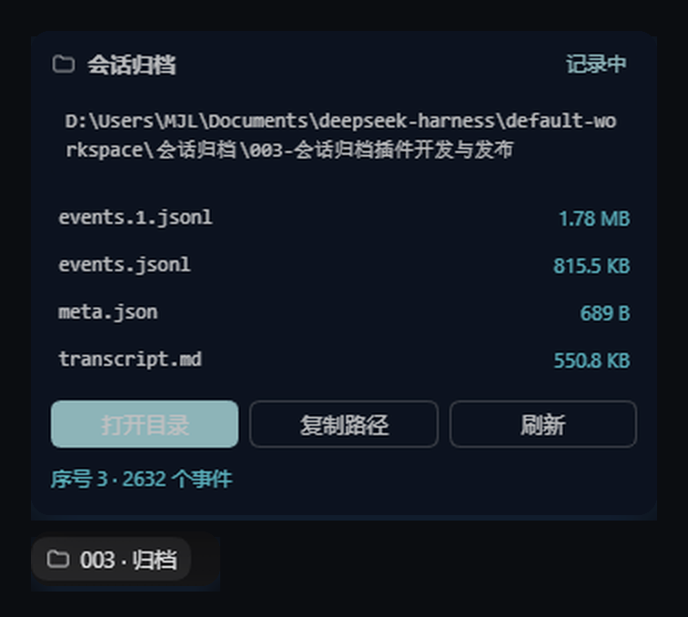

# session-archive

[中文](README.md) | English



That `003 · 归档` pill under the message composer is this plugin: open it to see which folder the current session lands in, which files it holds and how large each one is, with **open folder / copy path / refresh** actions.

A DeepSeek Harness (DSH) plugin that gives **every session its own numbered folder**. The folder is created when the session starts, renamed in place whenever the session title changes, and the sequence number never changes.

```
会话归档/
├── .index.json                 # sessionId → { seq, folder, title, lastSeq }
├── README.md                   # index table, re-generated (throttled to 2 s)
├── 001-整理默认工作区存储目录下的/
│   ├── transcript.md           # readable conversation: user / assistant / tool calls
│   ├── events.jsonl            # slimmed raw events, one JSON per line
│   ├── events.1.jsonl          # rotated shards once the log passes 8 MB
│   └── meta.json               # seq, title, cwd, model route, token usage, counts
└── 002-another-session/
```

## What it does

| When | Action |
| --- | --- |
| `session/created` | creates `<seq>-未命名会话/`, sequence from `.index.json` `nextSeq`, zero-padded to 3 |
| `session/event` | appends to `transcript.md` and `events.jsonl`; never rescans, never rewrites |
| `session/title` | renames the folder in place to `<seq>-<title>` after a 300 ms debounce |
| `session/disposed` | performs the final rename and flushes `meta.json` |
| every 20 events | persists `meta.json`, so a crash leaves a usable resume point |

### No duplicate writes

The resume point is the **maximum** of three sources: the index's `lastSeq`, the `meta.json` `lastSeq`, and the `seq` of the last line in `events*.jsonl` (found by reading the final 16 KB). A `lastWritten` guard covers the current lifetime as well. Verified by manually rolling `meta.json` back and restarting: zero duplicate events.

### Slim event log (default)

`assistant/message.data.stream` (the per-token timing stream) is dropped — it accounted for 73.8% of the log in practice. `tool/result` is truncated to `resultPreview` characters. `assistant/attempt`, `llm/retry*`, `request/context`, `image/offload`, and `job/*` are not written at all. Measured effect on a real session: **4.83 MB → 1.83 MB (−62%)** while `transcript.md` still carries the full text. Set `eventLogMode: full` to keep everything.

## Web

A `003 · 归档` pill appears under the composer. Clicking it opens a panel with the folder path, the file list and sizes, and `打开目录` / `复制路径` / `刷新`.

| Route | Purpose |
| --- | --- |
| `GET /session-archive/state?session=<id>` | seq, folder, file list, model route, token usage |
| `GET /session-archive/reveal?session=<id>` | opens the folder in the system file manager |

## CLI

```bash
node tools/archive-cli.mjs list                     # every session
node tools/archive-cli.mjs show 003                 # one session: folder, files, usage
node tools/archive-cli.mjs search 归档 --context 1   # full-text search in transcripts
node tools/archive-cli.mjs stats                    # size and token totals
```

Common flags: `--base <dir>` (default `./会话归档` or `$DSH_SESSION_ARCHIVE`), `--json`, `--limit`, `--context`.

## Install

```bash
# from a local checkout
dsh plugin add ./session-archive

# from the packed tarball
dsh plugin add ./local-session-archive-1.2.0.tgz
```

Or copy the directory into the profile and install the bundle through **Plugins → Add plugin**.

## Configuration

```yaml
- name: '@local/session-archive'
  config:
    baseDir: ''                      # pin one archive root; empty = <session cwd>/folderName
    folderName: 会话归档
    includeSubagents: false
    keepEventLog: true
    eventLogMode: slim               # slim | full
    transcript: true
    adoptExisting: false             # adopt sessions that already exist when enabled
    maxEventLogBytes: 8388608
    argsPreview: 240
    resultPreview: 1200
```

## Known limits

- Sequence numbers follow the order the plugin *sees* sessions, not session start time. With `adoptExisting: false`, an older session gets its folder on its next activity.
- Titles arrive a few messages in, so a folder is briefly named `未命名会话` before it is renamed — expected.
- `transcript.md` is an append-only readable summary; use `events.jsonl` for exact replay.
- If a folder is deleted by hand, the next event recreates it under the same indexed name and sequence.

## License

MIT
